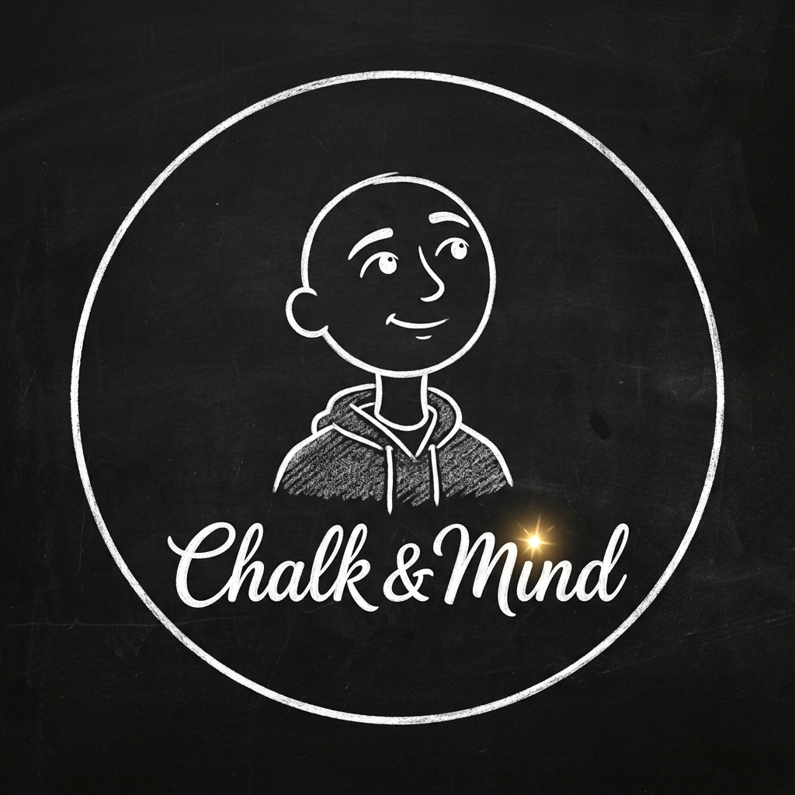

# 🎬 Chalk & Mind — Automated 2D Animation & Psychology Video Studio

<div align="center">



### **@chalk.mind**
**Automated 9:16 Reels & 16:9 Documentary Production Engine**

[](https://www.python.org/)
[](https://ffmpeg.org/)
[](LICENSE)
[](https://instagram.com/chalk.mind)

</div>

---

## 📖 Overview

**Chalk & Mind** is a fully automated video production studio designed to turn raw psychology concepts, emotional truths, and relationship dynamics into retention-optimized, broadcast-grade short-form videos (Instagram Reels / YouTube Shorts) and long-form animated documentaries.

This repository contains the **complete production pipeline**: from automated voice synthesis with broadcast audio mastering, tactile sound design, and karaoke subtitle rendering to pure 2D narrative cartoon animation engines.

---

## ⚡ Quick Start (Setup in 2 Minutes)

### 1. Prerequisites
- **Python 3.10+**
- **FFmpeg** (Ensure `ffmpeg` and `ffprobe` are in your PATH):
  ```bash
  # macOS (Homebrew)
  brew install ffmpeg

  # Ubuntu / Debian
  sudo apt update && sudo apt install -y ffmpeg

  # Windows (Chocolatey or Scoop)
  choco install ffmpeg
  ```

### 2. Clone & 1-Click Install
```bash
git clone https://github.com/adapajaisaipradhith/chalk-and-mind.git
cd chalk-and-mind
./setup.sh
```

The `setup.sh` script automatically:
1. Creates a Python virtual environment (`.venv`).
2. Installs all required packages (`edge-tts`, `pillow`, `numpy`, `scipy`).
3. Verifies FFmpeg and audio codecs.
4. Validates fonts, sound effects, and asset vaults.

---

## 🚀 Running & Rendering Videos

All production scripts are self-contained and render broadcast-ready MP4s directly into `output/reels/`:

```bash
# Render Reel #1: Pursuing vs. Chasing & Mutual Effort (Classic Minimalist Line Art)
.venv/bin/python scripts/generate_psychology_reel_remastered.py

# Render Reel #2: When He Goes Quiet vs. When She Stops Complaining (Kinetic Blueprint Slate)
.venv/bin/python scripts/generate_psychology_reel_02.py

# Render Reel #3: The Psychology of The "Strong One" (Pure 2D Cartoon Narrative - Style 4)
.venv/bin/python scripts/generate_psychology_reel_03.py

# Automated 9:16 Shorts Assembler with Dynamic ASS Karaoke Burner
.venv/bin/python scripts/assemble_short.py
```

---

## 🎨 Supported Visual Styles

| Style | Aesthetic & Theme | Visual Elements | Best Suited For |
| :--- | :--- | :--- | :--- |
| **Style 1: Classic Minimalist** | Obsidian chalkboard (`#0B0C0E`), crisp white chalk line art | Living eye blinks, breathing physics, golden-amber text underlines | Fast mental models, cognitive rules, self-worth axioms |
| **Style 2: Kinetic Blueprint** | Blueprint coordinates, technical grids, glassmorphism | Animated balance scales, battery meters, diagnostic card overlays | Relationship dynamics, unspoken communication breakdowns |
| **Style 4: Pure 2D Narrative Cartoon** | Full-scene illustrated environments (rainy bedrooms, night streetlights, sunrise) | Hero-scale characters, physical cartoon props (boulders, walls, companions), lower-third karaoke text | Deep parables, visceral storytelling, emotional case studies |

---

## 🧠 The 6 Zero-Skip Retention Rules

Every production script strictly implements the **6 Retention Laws**:

1. **Rule 1: The 1.2-Second Negative Contrast Hook**
   - Starts immediately with an emotional contradiction or raw unsaid reality. Frame 0 moves instantly with zero slow greetings.
2. **Rule 2: The Relatability Mirror**
   - Describes specific, visceral private behaviors (e.g., staring at an empty phone at 2:00 AM while carrying everyone else's burdens).
3. **Rule 3: Visual Novelty Every 2.5 Seconds**
   - No static screens. Constant micro-movement: character breathing, eye blinks, weather particles, and progressive prop interactions.
4. **Rule 4: Tactical Audio Ducking & The Zero-Volume Drop**
   - Complete acoustic silence for 0.8s right before the hardest-hitting psychological truth.
   - Mastered deep baritone narration (`en-US-ChristopherNeural`, $-7\%$ rate, $-10\text{Hz}$ pitch, with deep broadcast bass equalization).
   - High-impact synchronized SFX (boulder thuds, padlock snaps, crystal chimes).
5. **Rule 5: The Seamless Infinite Loop**
   - The final spoken line connects grammatically and tonally back into the opening hook, multiplying loop views.
6. **Rule 6: The Story Repost & Share Trigger**
   - Closes with a shareable emotional truth that viewers proudly repost to their stories.

---

## 📁 Repository Structure

```
chalk-and-mind/
├── .agents/skills/
│   └── directing-stickman-videos/   # Storyboard directives, prompt schemas, and camera rules
├── assets/
│   ├── branding/                    # Official Chalk & Mind watermark badge and circular emblem
│   ├── editing_toolkit/
│   │   ├── sfx/                     # 14+ tactical audio effects (whooshes, thuds, braams, chimes)
│   │   └── textures/                # Blueprint grids, stardust particles, vignette masks
│   ├── fonts/                       # Patrick Hand, Kalam, Caveat, Architects Daughter, Outfit
│   ├── online_vault/
│   │   ├── audio/                   # 320kbps Beethoven Moonlight Sonata, stems, rain ambience
│   │   └── lucide_icons/            # 1,899 crisp vector stroke icons (brain, heart, battery, etc.)
│   └── packages/                    # 698 UnDraw illustrations, 127 GL transitions, RoughJS, Popmotion
├── output/
│   ├── branding/                    # High-res 1024x1024 profile picture and PNG badges
│   └── reels/                       # Mastered export videos (Reels 1, 2, 3)
├── scripts/                         # Python video generators, TTS synthesizers, and audio masterers
├── AGENTS.md                        # Brand rules, memory, and schedule
├── HANDOFF.md                       # Complete collaborator handoff guide
├── README.md                        # Project documentation
└── setup.sh                         # 1-click automated environment setup
```

---

## 🤝 For Collaborators & Friends

If you are cloning this repository to continue development, read **[`HANDOFF.md`](HANDOFF.md)** for:
- Detailed breakdown of how each script generates frames and renders audio.
- How to write and launch **Reel #4** and **Reel #5**.
- Color palette tokens and typography hierarchy.
- Debugging and optimization tips.

---

## 📜 License
Distributed under the MIT License. See `LICENSE` for details.
